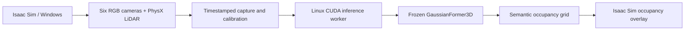

# GaussianFormer3D simulator integration

The worker runs in WSL Ubuntu 24.04 using `.venv-linux/` and `.toolchains/cuda/`. The simulator uses the pre-existing linked runtime; model packages are not installed into it. Source changes, captured frames, model weights, build products, package caches, and reports belong to this version.

## Sensor contract

- Six named pinhole RGB cameras in the upstream order: front, front-right, front-left, back, back-left, back-right.
- LiDAR points in metric sensor coordinates: x, y, z, intensity, time lag in seconds. Exported point coordinates are compensated into the current LiDAR frame using the measured simulator transforms.
- Eleven scans total (current plus ten earlier scans), sampled at 10 Hz. The sensor uses instantaneous full 360-degree scans, rather than modeling a continuously rotating beam and motion distortion.
- The PhysX LiDAR produces intersections with collision geometry, not image-plane depth. Its native 0–255 hit indicator is preserved without rescaling, and does not reproduce real material reflectance.
- Current-scan points are projected through calibrated transforms to form sparse camera-space depth guidance. No rendered camera-depth arrays are consumed by this inference path.
- RGB is rendered with a zero-time-step snapshot at the current scan pose. The driving launcher continues physics while the resident model worker processes that capture. The optional evaluation capture launcher pauses the vehicle for stationary inputs.

Ground-truth occupancy labels are not an inference input. Grid sample coordinates describe query locations only. Simulator poses are used for sensor registration and visualization; this does not establish camera/LiDAR localization on a real vehicle.

## Weight-preserving compatibility changes

The upstream mixes MMSEG legacy builders, modern MMSEG registries, MMDetection3D registries, and MMEngine's root registry. The local code consistently registers model components with MMEngine. ResNet and FPN come from MMDetection. The parameter-free HardSimpleVFE is implemented directly as the original per-voxel arithmetic mean, avoiding a complete MMDetection3D dependency for this one operation. Checkpoint loading must match every tensor strictly.

CUDA extensions include MMCV's deformable convolution and voxelization, DFA3D's attention operators, the Gaussian aggregation kernel, and the upstream 2D aggregation operator. Sparse convolution uses spconv's CUDA wheel and is tested on the actual GPU, rather than assumed compatible from package installation alone.

The sparse-lifter assignment was corrected to avoid writing to a temporary produced by chained advanced indexing when fewer LiDAR voxels than Gaussian anchors are present. Sparse tensor dimensions include the maximum coordinate. These changes add no learned parameters and do not train or fine-tune weights.

Evaluation now canonicalizes integer voxel coordinates and uses a private fixed
permutation for LiDAR-to-Gaussian assignment. This removes global RNG and voxel
emission order from assignment selection, while preserving the original sparse
and dense sampling policy and learned fallback anchors. Training retains random
assignment. The helper is preserved as a dependency overlay, and the lifter
integration is preserved in the upstream patch and idempotent patch helper.
This reduces sampling flicker; it does not provide missing sensor evidence or
eliminate residual GPU nondeterminism. See
[the paired accuracy and stability checks](../reports/anchor_assignment_fix/RESULTS.md).

## Display and interpretation

- Purple: model-predicted occupied voxels after confidence, height, radius, and semantic display filters.
- Yellow: current simulated LiDAR hits above the ground display cutoff.

Display filters do not alter saved raw model labels. A successful forward pass or plausible overlay establishes integration, not perception accuracy or safe autonomous driving. The active direct workflow exports paired per-frame USD snapshots for independent geometric occupancy scoring and latency measurement; see `OCCUPANCY_EVALUATION.md`. Semantic accuracy, broader scenarios and platform comparisons remain milestones.

## Driving path

The active implementation uses `driving_scene.py`, the WSL `driving_worker.py` and the CPU `planning_worker.py`. The retired ROS source is preserved only as a compressed historical backup in `project_materials/history/ros2_source.zip`.

`driving_scene.py` captures six cameras and eleven registered LiDAR sweeps, then sends each capture to a persistent WSL `driving_worker.py`. It reuses the frozen model without reloading weights each frame. Current-scan LiDAR supplies ray-carved free space and height-filtered obstacle evidence; GaussianFormer3D occupancy supplies semantic soft costs. The separate CPU planning worker runs hybrid A*, and the simulator applies throttle, brake, reverse, and steering through the reused vehicle controller. Street connectivity comes from the known road map. Simulator poses provide localization and sweep registration.

Unobserved space, vehicle footprint, braking footprint, prediction age, and delayed planner generations are checked before motion. A missing/stale prediction causes braking. A ground-truth collision watchdog stops the experiment on overlap and records a failure; collider geometry is not an obstacle input to the planner. RGB snapshots hide debug overlays. Native LiDAR intensity stays in its original 0–255 range. These heuristics and successful scenario tests do not replace perception accuracy evaluation.
